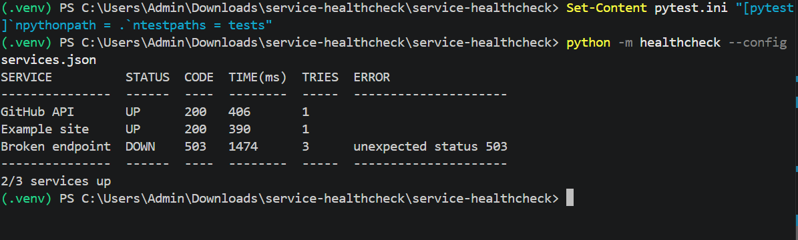

# Service Health-Check CLI


A small Python CLI that checks a list of websites/APIs after a deployment, retries failures,
logs every attempt, prints a summary table, and **exits non-zero if anything is down**, so it can
gate a CI/CD pipeline.

## Features
- Config-driven (`services.json`)
- Records HTTP status code and response time
- Configurable timeout and retries with linear backoff
- Log file of every attempt
- Exit codes: `0` all up, `1` something down, `2` bad config
- Dockerised, tested with pytest, CI via GitHub Actions

## Install
```bash
git clone https://github.com/PremaNR72/service-healthcheck.git
cd service-healthcheck
python -m venv .venv && source .venv/bin/activate
pip install -r requirements-dev.txt
```

## Usage
```bash
python -m healthcheck --config services.json --timeout 5 --retries 2
echo $?   # 0 = all up, 1 = at least one down
```

| Option | Default | Meaning |
|---|---|---|
| `-c, --config` | `services.json` | Path to config |
| `-t, --timeout` | `5` | Request timeout in seconds |
| `-r, --retries` | `2` | Extra attempts after a failure |
| `--backoff` | `1` | Base wait between retries |
| `-l, --log-file` | `healthcheck.log` | Log file path |

## Config
```json
{"services": [
  {"name": "API", "url": "https://api.example.com/health", "expected_status": 200},
  {"name": "Website", "url": "https://example.com"}
]}
```
If `expected_status` is omitted, any status below 400 counts as up.

## Example output
```
SERVICE         STATUS  CODE  TIME(ms)  TRIES  ERROR
--------------  ------  ----  --------  -----  -----------------------
GitHub API      UP      200   180       1
Broken endpoint DOWN    503   240       3      unexpected status 503
1/2 services up
```
  

## Docker
```bash
docker build -t healthcheck .
docker run --rm healthcheck
```

## Use in a pipeline
```yaml
- run: python -m healthcheck --config services.json   # fails the job if any service is down
```

## Tests
```bash
pytest -v
```
